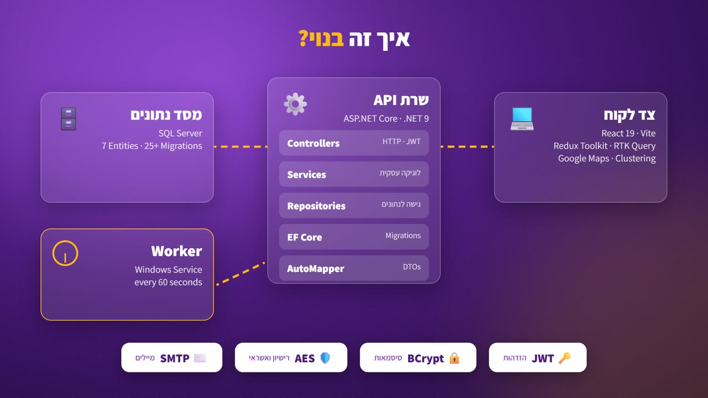
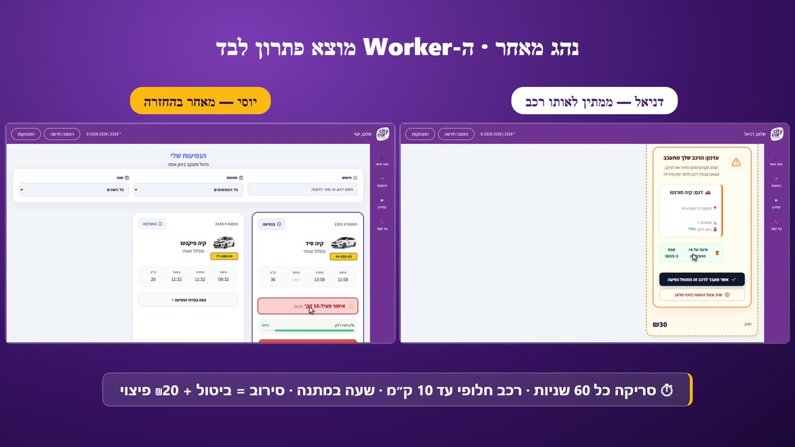

<h1 align="center">⏱️ CityCar · Worker Service</h1>

<p align="center">
  <b>שירות רקע שרץ כשירות Windows, וכל 60 שניות מנהל את מחזור החיים של כל ההזמנות במערכת, בלי שאף אחד ילחץ על כפתור.</b>
</p>

<p align="center">
  <a href="https://github.com/user-attachments/assets/1e423f95-8af3-4239-8bb7-d0af02f0d540"></a>
</p>

<h3 align="center">👇 הסרטון המלא עם קריינות (3 דקות) · לחצו ▶ להפעלה</h3>

https://github.com/user-attachments/assets/1e423f95-8af3-4239-8bb7-d0af02f0d540

---

## 🧩 המערכת המלאה: שלושה חלקים שעובדים יחד

| חלק | תפקיד | ריפו |
|------|--------|------|
| 💻 **צד לקוח** | React: מפה, הזמנות, נסיעות, פאנל ניהול | [SmartRide-Frontend](https://github.com/ahuviazulay3844/SmartRide-Frontend) |
| ⚙️ **שרת API** | ASP.NET Core 9 · לוגיקה עסקית · SQL Server | [SmartRide-Backend](https://github.com/ahuviazulay3844/SmartRide-Backend) |
| ⏱️ **Worker** | שירות Windows שסורק את ההזמנות כל 60 שניות | **הריפו הזה** |

ה-Worker לא מדבר עם השרת דרך HTTP. הוא משתמש **באותם Services ובאותו DbContext** של השרת, ועובד ישירות מול מסד הנתונים. כך הלוגיקה העסקית כתובה פעם אחת בלבד.

<p align="center"></p>

---

## 🔄 מה קורה בכל סבב (כל 60 שניות)

| שלב | מה קורה |
|------|---------|
| 1️⃣ **הפעלת הזמנות** | הזמנה ממתינה שהגיעה שעת ההתחלה שלה עוברת ל"בנסיעה". אם הרכב עדיין תפוס או בתחזוקה, מופעל תהליך רכב חלופי |
| 2️⃣ **סימולציית נסיעה** | עדכון קילומטראז' לנסיעות פעילות |
| 3️⃣ **זיהוי איחורים** | נסיעה שעברה את זמן ההחזרה מסומנת כמאחרת, והמשתמש רואה מונה איחור (₪1 לדקה) |
| 4️⃣ **פתרון התנגשויות** | אם נהג מאחר והזמנה אחרת ממתינה לאותו רכב, נמצא **הרכב הפנוי הקרוב ביותר (עד 10 ק"מ)** ומוצע לנהג הבא, עם שעה במתנה |

<p align="center"><br><i>יוסי מאחר בהחזרה (משמאל), ודניאל מקבל אוטומטית הצעה לרכב חלופי (מימין)</i></p>

---

## 🗂️ מבנה

```
SmartRide-Worker/
├── CityCar.Worker.sln
└── CityCar.Worker/
    ├── Program.cs        ← Host + DI: DbContext, Services, UseWindowsService()
    ├── Worker.cs         ← BackgroundService: לולאה כל 60 שניות
    └── appsettings.json  ← Connection String ל-SQL Server
```

הלוגיקה עצמה (`OrderTrackingService`) נמצאת ב-[SmartRide-Backend](https://github.com/ahuviazulay3844/SmartRide-Backend) בשכבת ה-Service.

---

## 🚀 התקנה והרצה

**1. משכפלים את שני הריפואים זה לצד זה** (הפרויקט מפנה ל-`../SmartRide-Backend`):

```
SomeFolder/
├── SmartRide-Backend/
└── SmartRide-Worker/
```

**2. הרצה רגילה (לפיתוח):**
```bash
dotnet run --project CityCar.Worker
```

**3. התקנה כשירות Windows**, ב-CMD כמנהל:
```cmd
dotnet publish CityCar.Worker\CityCar.Worker.csproj -c Release -o C:\CityCar\Published
sc create CityCarService binPath= "C:\CityCar\Published\CityCar.Worker.exe" start= auto
sc start CityCarService
```

**ניהול השירות:**

| פעולה | פקודה |
|--------|--------|
| עצירה | `sc stop CityCarService` |
| הפעלה | `sc start CityCarService` |
| בדיקת מצב | `sc query CityCarService` |
| לא לעלות אוטומטית עם המחשב | `sc config CityCarService start= demand` |
| לעלות אוטומטית עם המחשב | `sc config CityCarService start= auto` |

> 💡 החשבון שמריץ את השירות צריך הרשאת גישה למסד `CityCarDB` ב-SQL Server.
